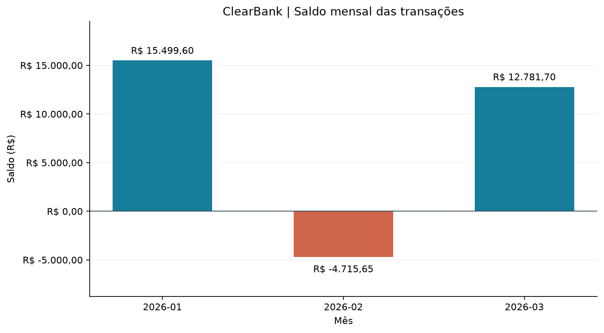

# ClearBank — Análise Financeira com Python

Projeto de **Thaís Sgalbiero**, desenvolvido para o desafio de Análise de Dados e Inteligência de Negócios com IA da Rocketseat. Processa transações fictícias, valida registros, calcula indicadores mensais e sinaliza valores superiores a R$ 10.000,00.

## Executar no Google Colab
1. Abra [o notebook no Colab](https://colab.research.google.com/github/thaisgalbiero/clearbank-analise/blob/main/desafio-final.ipynb).
2. Baixe deste repositório e envie pelo painel **Arquivos** do Colab: `transacoes.csv`, `analise_nativa.py` e `analise_pandas.py`.
3. Selecione **Ambiente de execução → Executar tudo**. Salve uma cópia para preservar as saídas.

## Executar localmente
Requer Python 3.10 ou superior. Abra um terminal na pasta do projeto:

```sh
python -m venv .venv
# macOS/Linux:
source .venv/bin/activate
# Windows: .venv\Scripts\activate
pip install -r requirements.txt
jupyter lab desafio-final.ipynb
```

Execute as células em ordem. A parte obrigatória também roda sem dependências externas com `python analise_nativa.py`. A alternativa pode ser executada com `python analise_pandas.py`.

## Arquivos e saídas
- `desafio-final.ipynb`: implementação organizada por etapas, testes e saídas salvas.
- `transacoes.csv`: base fictícia preparada antes da execução, com 26 registros.
- `analise_nativa.py`: funções reutilizáveis da solução principal, sem pandas.
- `analise_pandas.py`: leitura por `pd.read_csv` e agrupamento por `groupby`.
- `relatorio.json`: métricas, período, contagens, maiores/menores transações e alertas.
- `grafico.png`: saldo mensal gerado com matplotlib.

## Resultados da base de teste
| Mês | Quantidade | Créditos | Débitos | Saldo |
|---|---:|---:|---:|---:|
| 2026-01 | 5 | R$ 17.000,00 | R$ 1.500,40 | R$ 15.499,60 |
| 2026-02 | 5 | R$ 6.700,00 | R$ 11.415,65 | −R$ 4.715,65 |
| 2026-03 | 5 | R$ 14.500,00 | R$ 1.718,30 | R$ 12.781,70 |

São 15 registros válidos e 11 descartados (10 inválidos e 1 duplicata). Alertas: IDs 3 e 7. O valor de R$ 10.000,00 do ID 12 não ultrapassa o limite.



## Regras e testes
Validação de ID, cliente, data estrita, tipo e valor positivo finito. A primeira ocorrência válida de cada ID prevalece; duplicatas contam como descartes. O notebook testa cada validação, datas impossíveis, `NaN`, infinito, limite estrito, duplicatas, arquivo ausente, base vazia, persistência JSON e igualdade das sete métricas mensais com pandas.

Cálculos em `Decimal`, saída arredondada a centavos. Dias decorridos são recalculados na execução. O período analisado não corresponde a saldos bancários, pois não existe saldo inicial. A sinalização por valor não comprova fraude. Dados totalmente fictícios, sem informações bancárias reais.

O exemplo JSON do enunciado foi fornecido truncado; as chaves disponíveis foram preservadas e a estrutura foi complementada. As versões nativa e pandas compartilham a validação para manter as regras consistentes.
